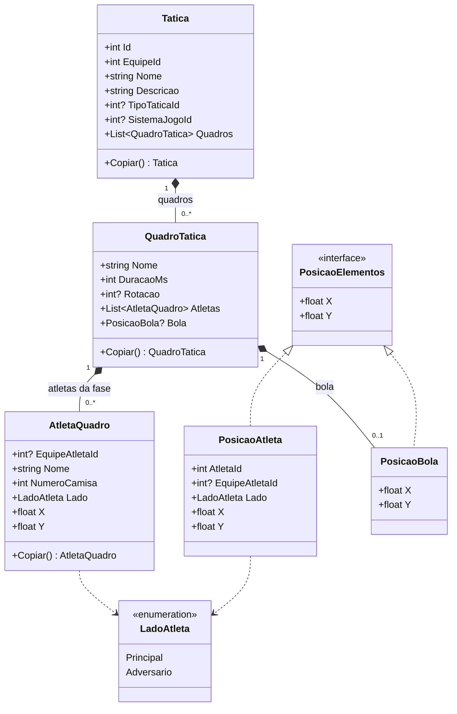
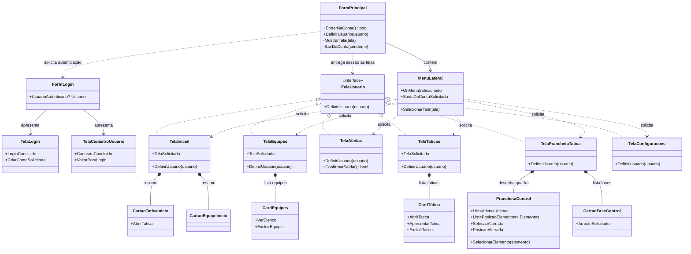

# Diagramas de classes do LIMK

O projeto organiza as telas do Windows Forms em `User Constrols` e as classes de domínio e acesso ao MySQL em `Backend`. Os diagramas mostram as relações entre esses componentes.

## 1. Modelo de domínio da prancheta

`AtletaQuadro` registra o número, o lado e a posição do atleta em uma fase. `PosicaoAtleta` e `PosicaoBola` implementam a interface de coordenadas usada para desenhar a quadra.

## 2. Classes de cadastro, sessão e persistência

O sistema representa usuário autenticado e atleta como classes de domínio. A camada de acesso a dados recebe ou devolve essas classes e usa `ConexaoBD` para criar conexões MySQL. `DataTable` é usado por algumas consultas das telas, por isso não foi desenhado como entidade.

```mermaid
classDiagram
    class UsuarioAutenticado {
        <<record>>
        +int Id
        +string Nome
        +string Email
    }

    class Atleta {
        +int Id
        +string Nome
        +string Apelido
        +int NumeroCamisa
        +DateTime? DataNascimento
        +int IdEquipe
        +bool Titular
    }

    class AtletaDaEquipe {
        +int EquipeAtletaId
        +string Nome
        +int NumeroCamisa
    }

    class PosicaoCadastro {
        <<record>>
        +int Id
        +string Nome
    }

    class PreferenciasUsuario {
        <<record>>
        +string CorAtletaPrincipal
        +string CorAtletaAdversario
        +string CorBola
        +int DuracaoQuadroPadraoMs
        +PreferenciasUsuario Padrao
    }

    class CadastroUsuario {
        <<static>>
        +CadastrarAsync(nome, email, senha) Task~UsuarioAutenticado~
    }

    class AutenticacaoUsuario {
        <<static>>
        +AutenticarAsync(email, senha) Task~UsuarioAutenticado?~
    }

    class DadosEquipe {
        <<static>>
        +SalvarAsync(usuarioId, equipeId, nome, escudo) Task~int~
        +ExcluirAsync(usuarioId, equipeId) Task
    }

    class DadosAtletas {
        <<static>>
        +CarregarPosicoesAsync() Task~List~PosicaoCadastro~~
        +SalvarAsync(usuarioId, atleta, posicaoIds) Task~int~
        +ExcluirAsync(usuarioId, atletaId, equipeId) Task
    }

    class DadosPrancheta {
        <<static>>
        +CarregarElencoAsync(usuarioId, equipeId) Task~List~AtletaDaEquipe~~
        +CarregarAsync(usuarioId, taticaId) Task~Tatica~
        +SalvarAsync(usuarioId, tatica) Task~int~
        +ExcluirAsync(usuarioId, taticaId) Task~bool~
    }

    class DadosPreferenciasUsuario {
        <<static>>
        +CarregarAsync(usuarioId) Task~PreferenciasUsuario~
        +SalvarAsync(usuarioId, preferencias) Task
    }

    class DadosUsuario {
        <<static>>
        +CarregarEquipesAsync(usuarioId) Task~DataTable~
        +CarregarAtletasAsync(usuarioId) Task~DataTable~
        +CarregarTaticasAsync(usuarioId) Task~DataTable~
    }

    class DadosInicio {
        <<static>>
        +CarregarAsync(usuarioId) Task~ResumoInicio~
    }

    class ResumoInicio {
        +long Equipes
        +long Atletas
        +long Taticas
        +long Quadros
        +List~TaticaInicio~ UltimasTaticas
        +List~EquipeInicio~ EquipesCadastradas
    }

    class TaticaInicio {
        +int Id
        +string Nome
        +string Descricao
        +string Equipe
        +long Quadros
    }

    class EquipeInicio {
        +string Nome
        +long Atletas
        +long Taticas
    }

    class ConexaoBD {
        <<static>>
        +CriarConexao() MySqlConnection
    }

    CadastroUsuario ..> ConexaoBD : grava conta
    AutenticacaoUsuario ..> ConexaoBD : consulta credenciais
    DadosEquipe ..> ConexaoBD
    DadosAtletas ..> ConexaoBD
    DadosPrancheta ..> ConexaoBD
    DadosPreferenciasUsuario ..> ConexaoBD
    DadosUsuario ..> ConexaoBD
    DadosInicio ..> ConexaoBD
    CadastroUsuario ..> UsuarioAutenticado : cria
    AutenticacaoUsuario ..> UsuarioAutenticado : retorna
    DadosAtletas ..> Atleta : persiste
    DadosAtletas ..> PosicaoCadastro : carrega
    DadosPrancheta ..> Tatica : carrega e salva
    DadosPrancheta ..> AtletaDaEquipe : carrega elenco
    DadosPreferenciasUsuario ..> PreferenciasUsuario : carrega e salva
    DadosInicio ..> ResumoInicio : retorna
    ResumoInicio "1" *-- "0..*" TaticaInicio
    ResumoInicio "1" *-- "0..*" EquipeInicio
```

## 3. Interface Windows Forms e navegação

`FormPrincipal` abre o login, mantém a sessão e troca os controles de tela. O botão **Sair da conta** no menu lateral devolve o usuário ao login. As telas autenticadas recebem o usuário por `ITelaUsuario`.

O [PDF para apresentação](entrega/diagrama-de-classes.pdf) destaca as relações entre os objetos de uma jogada e o fluxo entre sessão, cartões e operações de tática. O [MER](mer.md) apresenta as relações do domínio do ponto de vista dos dados.
