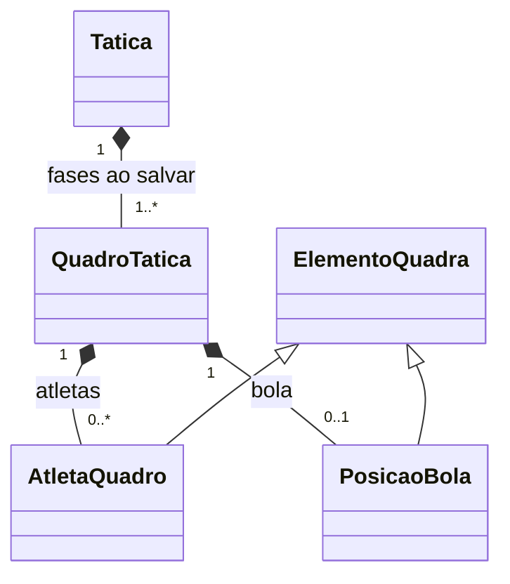
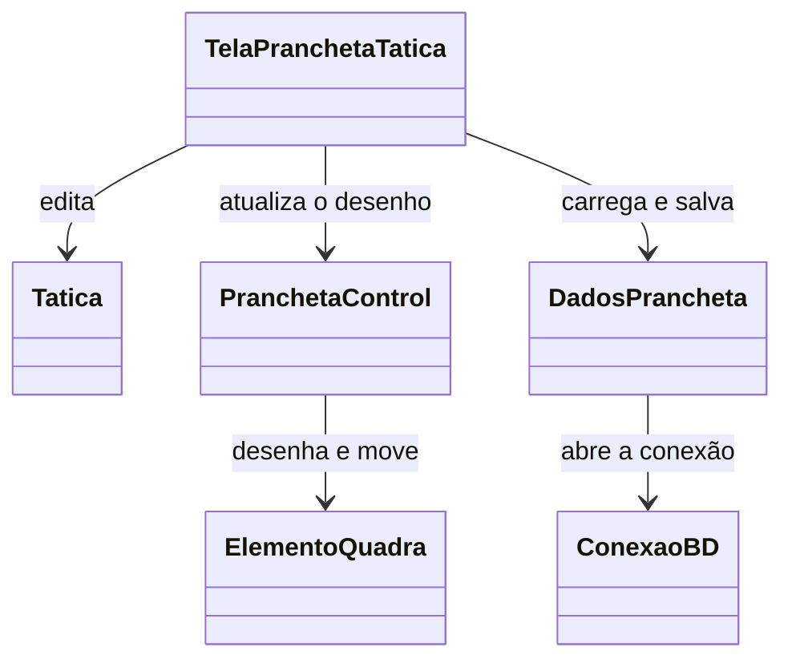

# Classes do LIMK Volleyball

## Da janela ao banco

Depois que a senha é aceita, a janela principal recebe o usuário e mostra uma tela por vez. O método de clique lê os campos, chama a classe de dados da área e mostra o resultado. Cada chamada ao MySQL termina antes de a tela continuar.

| Área | Quem recebe a ação | Quem consulta ou grava |
|---|---|---|
| Entrar ou criar conta | FormLogin, TelaLogin e TelaCadastroUsuario | DadosUsuario |
| Resumo das equipes | TelaInicial | DadosInicio |
| Equipes | TelaEquipes | DadosEquipe |
| Elenco | TelaAtletas | DadosAtletas. DadosEquipe fornece as equipes do seletor |
| Lista e editor de táticas | TelaTaticas e TelaPranchetaTatica | DadosPrancheta |
| Preferências | TelaConfiguracoes | DadosPreferenciasUsuario |

Cada classe de dados usa o ID do usuário nas operações que dependem de acesso. ConexaoBD abre a conexão e fornece a consulta de tabelas usada nas listas.

## Objetos de uma jogada

Uma tática contém uma sequência de fases. O número da camisa, o lado e as coordenadas do atleta pertencem àquela fase. A associação opcional com o elenco usa o ID do vínculo entre equipe e atleta.

ElementoQuadra contém X e Y. O controle de desenho pode chamar GetX() ou GetY() para qualquer objeto dessa família. AtletaQuadro também fornece GetNumeroCamisa() e GetLado(). Cada fase mantém seus próprios objetos. A tela usa Copiar() quando leva esses objetos para o desenho ou os traz de volta.

## Dentro da prancheta

PranchetaControl.CalcularQuadraNaTela() calcula onde a quadra aparece em pixels. CalcularCentroNaTela() usa esse retângulo e as coordenadas relativas para localizar cada círculo. OnMouseMove() faz a conta inversa durante o arraste. OnPaint() volta a desenhar a imagem e os círculos quando o Windows solicita uma pintura.

## Quando uma operação falha

Tatica.Validar() lança ValidacaoException, por exemplo, ao encontrar duas camisas iguais do mesmo lado. DadosPrancheta.Salvar() reúne cabeçalho e fases em uma transação. Se o MySQL falhar, a classe informa BancoDeDadosException e preserva a causa original. A tela captura a exceção, informa o problema e mantém a edição disponível.

O [modelo de dados](mer.md) mostra as relações entre as tabelas. O [PDF de 21/11](entrega/diagrama-de-classes.pdf) corresponde à entrega anterior.
