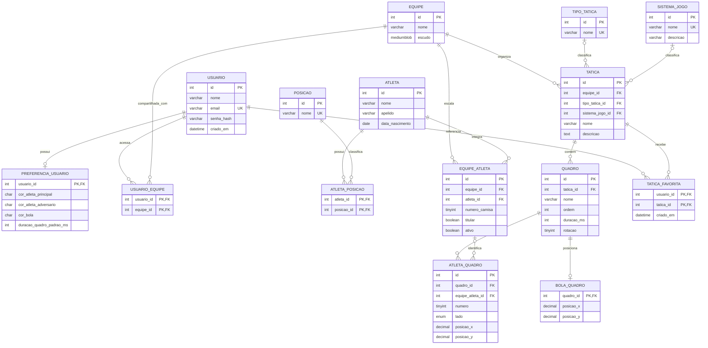

# EER do banco de dados do LIMK

Esta representação física foi produzida a partir das 15 tabelas e das chaves estrangeiras de [limk-completo.sql](../banco/limk-completo.sql). O [modelo conceitual](mer.md) apresenta o domínio da aplicação.

## Como interpretar

- **PK** identifica a chave primária; **FK**, uma chave estrangeira; **UK**, uma restrição de unicidade.
- `USUARIO_EQUIPE` resolve o relacionamento muitos-para-muitos entre usuários e equipes: uma equipe pode ser compartilhada com vários usuários.
- `EQUIPE_ATLETA` representa a participação de um atleta no elenco de uma equipe. É nessa relação que ficam número da camisa, titularidade e situação ativa. O mesmo atleta pode integrar equipes diferentes.
- `ATLETA_POSICAO` resolve o relacionamento muitos-para-muitos entre atletas e posições.
- `ATLETA_QUADRO` guarda a posição e o número do atleta em um quadro específico. O vínculo opcional com `EQUIPE_ATLETA` permite representar atletas adversários sem cadastro no LIMK.
- `BOLA_QUADRO` tem `quadro_id` como chave primária e estrangeira; assim, cada quadro pode ter zero ou uma bola registrada.
- `TATICA_FAVORITA` contém registros do script de demonstração e referencia usuário e tática. O escopo funcional está em [LIMK_Requisitos.md](LIMK_Requisitos.md).
- O modelo atual não tem tabela separada para projeto: cada tática pertence diretamente a uma equipe.

## Cardinalidades importantes

| Relacionamento | Cardinalidade | Interpretação |
|---|---|---|
| Usuário — Preferência | 1 para 0..1 | Uma conta pode ter uma linha de preferências. |
| Usuário — Equipe | N para N | Usuários acessam equipes por `usuario_equipe`. |
| Equipe — Atleta | N para N | O vínculo e os dados do elenco ficam em `equipe_atleta`. |
| Atleta — Posição | N para N | Um atleta pode ter várias posições; uma posição pode pertencer a vários atletas. |
| Equipe — Tática | 1 para N | Cada tática referencia uma equipe. |
| Tática — Quadro | 1 para 0..N | Uma tática pode conter vários quadros; cada quadro pertence a uma tática. |
| Quadro — Atleta no quadro | 1 para 0..N | Um quadro pode registrar vários atletas posicionados. |
| Quadro — Bola | 1 para 0..1 | Cada quadro pode ter no máximo uma posição de bola. |
| Usuário — Tática favorita | N para N | `tatica_favorita` registra os favoritos. |

As cardinalidades refletem as chaves e restrições do MySQL. No aplicativo, o editor exige pelo menos uma fase para salvar a tática. O [MER conceitual](mer.md) inclui essa regra.
