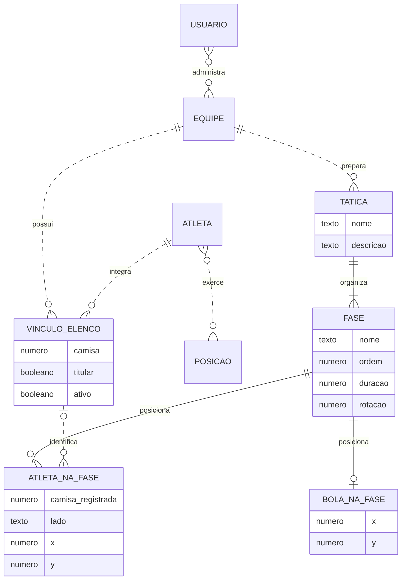

# Modelo conceitual do LIMK Volleyball

O usuário administra equipes. Cada equipe organiza o elenco e suas táticas. Uma tática é apresentada como uma sequência de fases, nas quais o treinador posiciona os atletas e, se desejar, a bola.

O vínculo de elenco explica por que um atleta pode usar camisas diferentes em duas equipes. Um atleta desenhado na fase pode ser genérico. Quando vem do elenco, a fase conserva o número daquela cena, mesmo que a camisa da equipe mude depois.

A multiplicidade de uma ou mais fases expressa a regra de salvamento da aplicação. No MySQL, cada quadro referencia uma tática, mas a chave estrangeira sozinha permite uma tática sem quadros. O [diagrama do esquema físico](eer.md) detalha as 15 tabelas.
