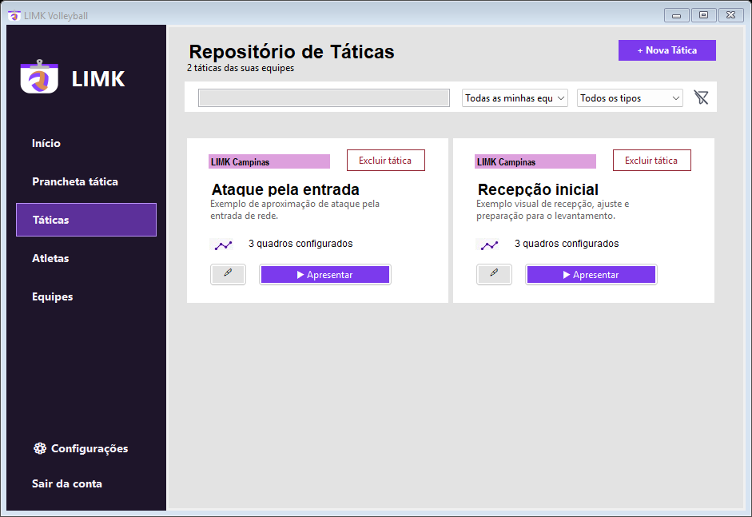

# Testes funcionais do LIMK Volleyball

Em 21/11/2026, o aplicativo Windows Forms foi exercitado com MySQL Server 8.0.46 em uma instância local, criada vazia para o ensaio. As interações com os controles foram automatizadas e as alterações persistidas foram verificadas por uma segunda leitura do banco. O ensaio usou memória compartilhada no Windows. A conexão TCP padrão da instalação ainda precisa ser conferida no notebook da apresentação.

## Resultados

| Função | Verificação executada | Resultado observado |
|---|---|---|
| Compilação e identidade visual | Compilar a configuração Release, abrir o login e autenticar. | Compilação com zero erros e avisos. O login e a janela principal exibiram o ícone do projeto. A janela principal registrou o nome `FormPrincipal` e o título **LIMK Volleyball**. |
| Banco e consultas | Importar [limk-completo.sql](entrega/limk-completo.sql) em uma instância nova. | O catálogo registrou 15 tabelas e 16 chaves estrangeiras. O conjunto inicial continha 3 contas, 4 táticas e 12 quadros. As 24 consultas de leitura e verificação executaram com os parâmetros de demonstração. |
| RF01 e RF02 | Autenticar com senha válida e inválida e cadastrar outra conta. | As credenciais válidas identificaram a conta, as inválidas foram recusadas e a conta nova recebeu as preferências padrão. |
| RF04 e RF07 a RF10 | Criar equipe, cadastrar atleta com duas posições e retirar o atleta do elenco ativo. | O criador ganhou acesso à equipe, a camisa apareceu no elenco e o vínculo deixou de aparecer nas opções ativas após a retirada. Uma fase já salva conservou a referência. |
| RF14, RF16 e RF22 | Duplicar uma fase, alterar o destino e salvar a sequência de duas fases. | A releitura recuperou posições distintas nas duas fases, duração e rotação da fase inicial e a bola na cópia. |
| RF20 e RF21 | Acionar o arraste de atleta e bola no controle da quadra. Alterar o atleta para X = 25% e Y = 75%, aplicar e salvar a tática. | A releitura confirmou 0,25 e 0,75 no atleta da primeira fase, a nova posição da bola e a conservação da outra fase. |
| RF23 | Usar **Executar** e **Parar** na tela da prancheta. | O comando alternou para **Parar** durante a apresentação e voltou a **Executar** após a interrupção. |
| RF11 | Em um cartão de teste, cancelar a exclusão e repetir confirmando a operação. Consultar a tática e seus registros dependentes após confirmar. | O cancelamento conservou o cartão. A confirmação atualizou a lista e removeu a tática, seus quadros e o favorito de demonstração. Outra tática foi preservada. Repetir a operação para o mesmo ID retornou que o alvo estava indisponível. |
| Acesso e integridade | Tentar excluir uma tática com uma conta sem vínculo. Depois, excluir uma equipe criada para o ensaio com a conta autorizada. | A primeira exclusão foi recusada. A segunda removeu a tática da equipe de teste e o cadastro do atleta exclusivo. |
| RF03 | Sair, entrar com uma conta vinculada a outra equipe e sair novamente. Fechar o novo login. | A tela anterior foi descartada. O login abriu com a senha em branco e a segunda conta consultou apenas a própria equipe. Fechar o login encerrou o aplicativo. |

A imagem mostra a tela **Táticas** após a exclusão da jogada de teste. As duas táticas de demonstração da equipe continuam na lista.

## Como repetir os fluxos centrais

1. Em uma instância de demonstração vazia, execute [limk-completo.sql](../banco/limk-completo.sql) pelo cliente MySQL. Para consultar cada comando separadamente, abra [consultas-interfaces.sql](entrega/consultas-interfaces.sql).
2. Configure a conexão da aplicação e abra o projeto conforme o [README](../README.md). Use as contas de demonstração descritas nele.
3. Entre como Ana, crie uma tática de teste vinculada a **LIMK Campinas**, insira um atleta e uma bola e duplique a fase. Na primeira fase, arraste a bola, informe 25% e 75% para o atleta, aplique e salve. Feche e reabra a tática. Confira as duas fases e use **Executar** e **Parar**.
4. Na tela **Táticas**, localize a tática de teste, escolha **Excluir tática** e cancele. Em seguida, confirme a exclusão dessa mesma tática e verifique os outros cartões.
5. Use **Sair da conta** e entre como Carla. Confira se a lista de táticas mostra a equipe **Vôlei Hortolândia**. Saia outra vez e feche o login.

## Validação com a comunidade

O depoimento do treinador sobre a experiência com a versão Windows Forms foi datado de **20/11/2026**. O [trabalho escrito](entrega/trabalho-escrito.pdf) transcreve o relato e registra os critérios de adoção. A execução técnica documentada acima ocorreu em **21/11/2026**.
